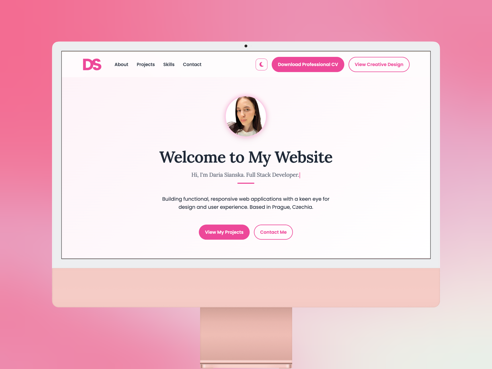

# 🌟 Personal Portfolio — Daria Sianska

[](https://dariasyanska.github.io/portfolio/)
[](https://developer.mozilla.org/en-US/docs/Web/HTML)
[](https://developer.mozilla.org/en-US/docs/Web/CSS)
[](https://developer.mozilla.org/en-US/docs/Web/JavaScript)

[](https://dariasyanska.github.io/portfolio/)

## ✨ About the Project

This is my personal portfolio website. It presents my work as a **Junior Frontend Developer** focused on React, TypeScript, Next.js, and usable web interfaces. I am a Computer Science student and do not present the projects below as commercial experience.

The goal is to make my role, selected projects, and contact details easy to review. The portfolio is a static HTML/CSS/JavaScript site; project demos have their own limitations described in their repositories.

---

## 🚀 Key Features

- 🌓 **Dark / Light Mode**
  Persistent theme switching using `localStorage`.

- 📱 **Responsive Layout**
Responsive styles are implemented; device and accessibility audits should be treated as ongoing work rather than a performance guarantee.

- 🎨 **UI/UX Focus**
  Clean layout, strong typography, and attention to visual hierarchy.

- 📩 **Contact Form Integration**
  Powered by Formspree for handling submissions.

- ⚡ **Assets and Styling**
The site uses WebP images, CSS variables, and a BEM-style stylesheet. No benchmark score is claimed.

---

## 🛠️ Tech Stack

**Frontend**
- HTML5 (semantic markup)
- CSS3 (BEM methodology, CSS variables, responsive design)
- JavaScript (ES6+)

**Design**
- Figma (wireframes, UI, prototyping)

**Libraries**
- [AOS](https://michalsnik.github.io/aos/) — scroll animations
- [Typed.js](https://mattboldt.github.io/typed.js/) — typing effect
- [FontAwesome](https://fontawesome.com/) — icons

---

## 🎯 What This Project Demonstrates

- Ability to build a fully responsive UI from scratch
- Strong understanding of UI/UX and visual hierarchy
- Clean and maintainable CSS architecture (BEM)
- Implementation of interactive and dynamic UI features
- Semantic markup and interactive UI patterns; accessibility and performance require ongoing manual and automated checks

---

## 🔗 Live Demo

[🌐 View Live Portfolio](https://dariasyanska.github.io/portfolio/)

---

## 📬 Contact

- 💼 LinkedIn: https://www.linkedin.com/in/daria-sianska/
- 📩 Email: [daria.syanska@gmail.com](mailto:daria.syanska@gmail.com)

---

## 📂 Project Structure

```text
/
├── index.html           # Main landing page (portfolio overview)
├── success.html         # Confirmation page after form submission
├── contract.html        # Terms of cooperation / contract details
├── hire-me.html         # Contact & collaboration page (lead capture)
├── privacy.html         # Privacy policy (GDPR compliance)
├── terms.html           # Terms & conditions of website usage
├── css/
│   └── styles.css       # Core styling (themes, layout, responsiveness)
├── js/
│   └── script.js        # UI logic (dark/light mode, scroll animations, AOS)
├── images/              # Optimized assets (WebP, UI previews, icons)
└── CV_Daria_Sianska.pdf # Downloadable CV / resume
